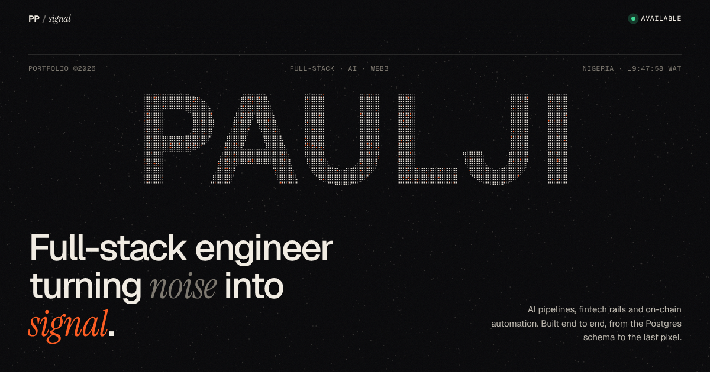

# SIGNAL: Paulji Peters' portfolio

> Full-stack engineer turning *noise* into **signal**.

A hand-built portfolio with **zero frameworks and zero dependencies**: just HTML, CSS and modern JavaScript.
Every featured project shows **real screens captured from the running app**, a **live diagram drawn in code**
that explains how it works, and a **case study** that opens with a View Transition.



---

## The idea

Every project in this GitHub account finds a signal hidden in noise:

| Project | The noise | The signal |
|---|---|---|
| Ncliper | a 4-hour stream | the 60 seconds worth posting |
| Lezerv | a city full of artisans | the verified one who quotes firm after a site visit |
| EFitMi | a phone photo | your measurements in centimetres |
| N-Reclaim | thousands of token accounts | the zombie ones holding your SOL |
| Final-year project | a moving hand | play / pause / rewind |

So the whole site is built on that idea. The hero turns static into your name, and your cursor adds noise back in.

## Run it locally

ES modules (`import … from`) don't load from `file://` (browsers block them for security), so serve the folder:

```bash
python3 -m http.server 8080      # or: npx serve .
# open http://localhost:8080
```

## Update the content

**All text lives in [`js/data.js`](js/data.js).** Add a project, change a date or fix a stat there.
You never need to touch the HTML for content changes.

- `featured`: the five big project chapters. `shots` are the real screens, `gallery` feeds the case study,
  `visual` picks the animated diagram in `visuals.js`.
- `archive`: every repo row. `cat` can hold several filter categories (`"ai web3"`).
- `layers`, `journey`, `stats`, `marquee`: the other sections.

## File map (and what each one teaches)

| File | What it does | Technique worth learning |
|---|---|---|
| `index.html` | Page skeleton + static sections | Semantic HTML, `sr-only` text for screen readers, JSON-LD for Google |
| `css/style.css` | All styling | Design tokens, **`@property`** to animate CSS variables (the cream "scene change"), `clamp()` fluid type |
| `css/fonts.css` | Self-hosted fonts | `unicode-range` subsetting: the browser downloads only what the page uses |
| `js/main.js` | Boot order + preloader | `async/await` sequencing, `document.fonts.load` |
| `js/data.js` | Content | Separating content from presentation |
| `js/render.js` | Data → HTML | Template literals, escaping (`esc()`) to avoid XSS |
| `js/hero.js` | Particle name | Sampling text pixels with `getImageData`, springs + flow fields, batching canvas draws |
| `js/visuals.js` | Live diagrams | Pure functions of time `draw(t)`, easing, Bézier curves, pausing off-screen work |
| `js/sheet.js` | Figure tabs + case studies | `<dialog>`, the **View Transitions API** (screenshot → sheet header), lazy-starting canvases |
| `assets/work/` | Real screenshots | Captured with Playwright from each app running locally, exported as WebP |
| `js/portrait.js` | Halftone portrait + lens | Luminance, gamma correction, canvas clipping |
| `js/motion.js` | Scroll + pointer effects | `IntersectionObserver`, one `requestAnimationFrame` loop, read-then-write to avoid layout thrashing, lerp |

## Built-in care

- **Reduced motion:** if your OS asks for less motion, every animation freezes on a meaningful final frame.
- **No-JS fallback:** content is never hidden unless JavaScript is running (`.js` class trick in `<head>`).
- **Performance:** canvases only animate while on screen, device pixel ratio is capped at 2, particle count adapts to screen size, fonts are preloaded and self-hosted.
- **Keyboard + screen readers:** skip link, visible focus rings, labelled canvases, real `` behind the halftone.

## Easter eggs

- Open the browser console.
- Type the Konami code on the page: `↑ ↑ ↓ ↓ ← → ← → B A`.

## Deploy

**Vercel:** import the repo → Framework preset **Other** → no build command → deploy.
**GitHub Pages:** Settings → Pages → deploy from branch → `/ (root)`.

After deploying, change `og:image` in `index.html` to the full URL (e.g. `https://your-site.com/assets/og.png`), because LinkedIn and X need an absolute link to show the share card.

---

## How the screenshots were made

Each app was run locally from its repository with placeholder keys (no real databases touched) and captured
with Playwright. Where a screen needed data to render, the case study says so: Lezerv's artisan cards are
sample data, N-Reclaim's scan answers were simulated in the browser (the totals are the app's own maths).

Data sources: the GitHub repos under [`soma-connects`](https://github.com/soma-connects) and Paulji's CV.
"250K+ lines" counts TS/JS/Vue/PHP/Python/Rust/SQL/CSS across all repos, excluding dependencies, lockfiles and build output.
